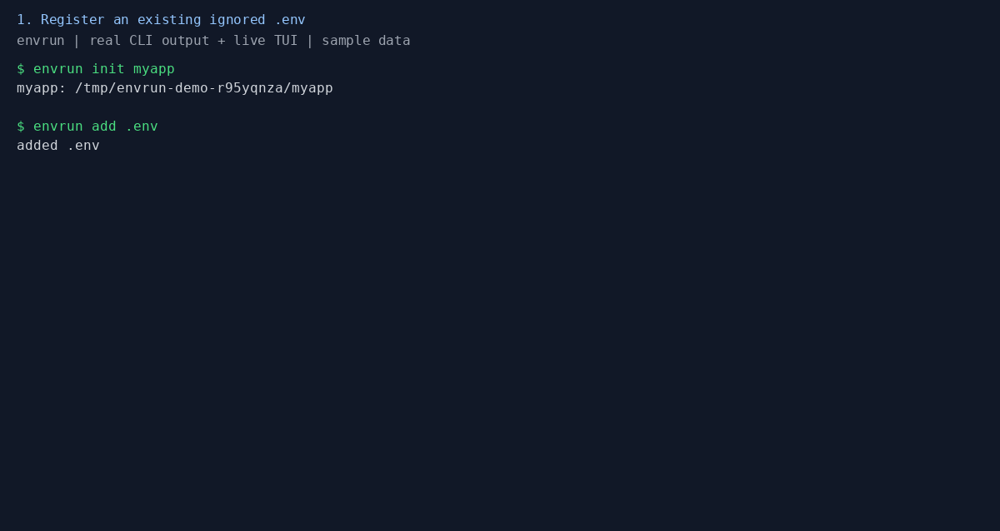

# envrun

**Stop copying `.env` files between Git worktrees.**

New worktree, missing `.env`, broken dev server? Register your ignored env files once, link them into each worktree, and run commands with the right environment. Open the terminal UI to browse files and keys with values masked by default.

Useful for parallel branches, monorepos, and coding agents working in separate Git worktrees. Runs on macOS and Linux.



[Quick start](#quick-start) · [Coding agents](#working-with-coding-agents) · [Usage guide](docs/usage.md) · [Report an issue](https://github.com/hikionori/envrun-cli/issues)

> **Public beta · Source-available · Noncommercial license.** Files are stored locally in plaintext, with no encryption or team sync. See [storage and behavior](#storage-and-behavior) and [license](#license).

## Install

```sh
cargo install envrun-cli --locked
```

Requires Rust and Cargo. The package is `envrun-cli`; the command is `envrun`. See the [usage guide](docs/usage.md#installation) for installation from GitHub or a local checkout.

## Quick start

From the root of an existing Git repository, register an ignored `.env` file:

```sh
envrun init myapp
envrun add .env
```

Choose an unused project name in place of `myapp`. The `.env` file must already exist and be ignored by Git. `add` copies it to a local store, verifies the copy, and replaces the original with a symlink. **Editing a linked file updates the shared copy for every linked worktree.**

Create another worktree and connect its env files:

```sh
git worktree add -b feature-x ../myapp-feature
cd ../myapp-feature
envrun link
envrun run -- npm run dev
```

Replace `npm run dev` with your application's command. `link` only links files whose parent directories exist and refuses conflicting files. Run `envrun status` to check the links, or `envrun run --explain` to see file paths, sources, and key names without values or command execution.

To give this worktree an independent copy later:

```sh
envrun unlink .env
envrun run --source local -- npm run dev
```

## Why envrun?

- **One local store across worktrees.** Link env files explicitly instead of maintaining copies.
- **Multiple paths for monorepos.** Register `.env`, `services/api/.env`, and other files separately.
- **Environment loading for any command.** Load ancestor `.env` files from the repository root through the current directory.
- **Inspect before running.** `run --explain` shows file paths, sources, and key names without values.
- **A terminal UI.** Browse and edit files and keys with values masked by default.
- **Independent settings when needed.** Unlink a file and explicitly choose the local or shared source.

## Working with coding agents

Running Codex or another coding agent in a separate Git worktree? Ignored env files don't come along with the checkout. After registering them in your main checkout, run `envrun link` in each agent's worktree, then start your usual command through `envrun run -- …`.

No agent-specific integration is needed. Linking is explicit; envrun does not create worktrees or configure agents. Linked files share edits, so use independent local copies when tasks need different settings. Processes started through `run` receive the selected values; masking in the TUI does not restrict a process or agent's access to them.

## Monorepos and the terminal UI

From the repository root, discover and register the files you want to share:

```sh
envrun scan
envrun add services/api/.env services/web/.env
envrun
```

Use existing, ignored paths from the scan output. In the TUI, press `r` to reveal the selected value and `?` for help. Changes to linked files affect the shared copy.

To load both the root and service `.env` files:

```sh
cd services/api
envrun run -- npm run dev
```

## Storage and behavior

- **Local plaintext:** shared files live under `$XDG_CONFIG_HOME/envrun/projects/<name>/files/`, or `~/.config/envrun/...`. Store directories and files are private to the current Unix user. There is no encryption or team secret synchronization.
- **Shared edits are immediate:** linked files point to the same stored copy. Use `unlink` for an independent worktree copy; [the usage guide](docs/usage.md#manage-files-and-worktrees) explains relinking, backups, and removal.
- **Conflicting sources need a choice:** when independent local and shared copies both exist, the default `auto` policy refuses to pick one. Use `--source local` or `--source shared`, even if their contents match.
- **Review before running:** `run` also includes local-only ancestor `.env` files. Later files override earlier files and inherited shell variables. Use `envrun run --explain` to inspect the selection.
- **Values are available to the command:** masking keeps values out of the default TUI view; it does not prevent commands from reading or printing their environment.

## Documentation and feedback

- [Files, worktrees, separate clones, and removal](docs/usage.md#manage-files-and-worktrees)
- [Running commands, precedence, expansion, and source selection](docs/usage.md#run-commands)
- [Key editing and TUI controls](docs/usage.md#manage-keys-and-use-the-tui)
- [Shell completion and suggested commands](docs/usage.md#suggestions-and-completion)
- [Reproduce the demo](docs/demo.md)

Hit a rough edge? [Open an issue](https://github.com/hikionori/envrun-cli/issues/new) with your OS, `envrun --version`, and steps to reproduce. Use sample values and remove credentials from any output you share. Workflow suggestions are welcome too.

Know someone who keeps copying `.env` files into worktrees? Send them this repo. If envrun helps your workflow, consider giving it a star.

## License

The source is available under the [PolyForm Noncommercial License 1.0.0](LICENSE). Noncommercial use, modification, and sharing are permitted under its terms. Commercial use by others is not licensed; Danila Verbinskiy retains the option to use and sell the software commercially. This is a source-available project, not an open-source license.
