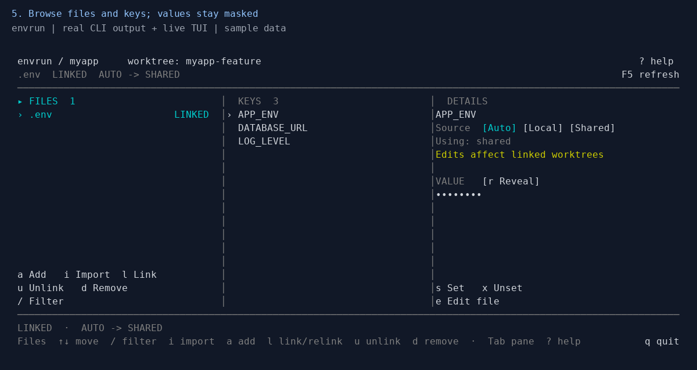

# Reproduce the README demo

[← Back to the README](../README.md)

The GIF contains actual CLI output and frames captured from the live terminal UI. Commands are run in a temporary Git repository with fake development values and an isolated envrun store. The recorder removes the fixture afterward; it does not import your env files. Each CLI scene is rendered from the command's output, rather than a continuous screen recording.

## Record

On Linux with Python 3, Git, Rust/Cargo, and a monospace TrueType font:

```sh
cargo build --locked
python3 -m venv /tmp/envrun-demo-venv
/tmp/envrun-demo-venv/bin/pip install Pillow pyte
/tmp/envrun-demo-venv/bin/python docs/record_demo.py
```

The default font is DejaVu Sans Mono at `/usr/share/fonts/truetype/dejavu/DejaVuSansMono.ttf`. On macOS or a system with a different font path, pass `--font /path/to/monospace.ttf`. Pass `--binary /path/to/envrun` to capture a different build.

Outputs:

- [`assets/demo.gif`](assets/demo.gif): the looping CLI and TUI walkthrough embedded in the README.
- [`assets/tui.png`](assets/tui.png): a static TUI capture for a closer look.

The sequence registers `.env`, creates a worktree, links files, inspects source selection, runs a shell command with the selected environment, and opens the TUI with values masked. The fixture includes a fake database URL; none of the values are real credentials.


